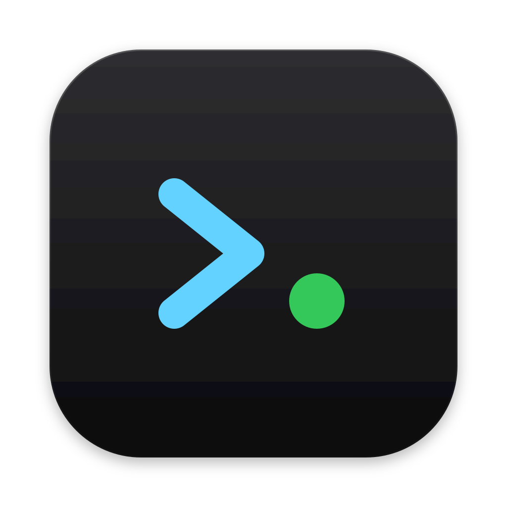

<p align="center">
  
</p>

<h1 align="center">LLM Bar</h1>

<p align="center"><strong>Every model you can reach, and every worktree your agents made, in the macOS menu bar.</strong></p>

<p align="center">
  <a href="https://github.com/sriinnu/llm-bar/releases/latest"></a>
  
  
  <a href="LICENSE"></a>
  <a href="https://github.com/sponsors/sriinnu"></a>
</p>

LLM Bar is a native menu bar app for people who run coding agents all day. One click shows your
local models (llama.cpp, Ollama, Hugging Face), your Claude Code provider lanes with live health,
and every git worktree your agents created, with who is working where and what is safe to clean up.

Native AppKit + SwiftUI. No Electron, no Python runtime in the app, no SwiftBar/xbar. Signed,
notarized, auto-updating via Sparkle.

## Install

```bash
brew install --cask sriinnu/tap/llmbar
```

Or download the notarized `.zip` from [Releases](https://github.com/sriinnu/llm-bar/releases).
Menu bar only, no Dock icon. Turn on **Launch at login** in Settings → General.

Requires macOS 14 or later.

## The three tabs

Open the popover and switch with the segmented control or **⌘1 / ⌘2 / ⌘3**.

### Lanes

Every Claude Code provider launcher in your `~/.claude_config.zsh` (DeepSeek, Kimi, Qwen, GLM,
SiliconFlow, OpenRouter, …). Each lane shows a health dot (green ok · yellow rate-limited ·
red auth / balance / down · orange no key · grey not probed), its description, the last probe's
latency and, with [kosha](https://github.com/sriinnu/kosha-discovery) installed, the model's price
per million tokens. The terminal button opens the lane in a new Ghostty window (Terminal.app works
too).

### Models

- **llama.cpp**: GGUF files in your models folder, with start / stop for `llama-server` (memory-checked first). Split GGUFs count as one model.
- **Ollama**: models from the local API, cloud-proxied ones marked; start or quit Ollama.app from the row.
- **Hugging Face**: repos in your cache, sized on disk.

The terminal button opens a model in **Claude Code**: llama.cpp models through `lcp <model>`, Ollama
models through `ollama launch claude --model <name>`. Right-click for **Copy Path**, **Copy Name**,
**Reveal in Finder** and, for Ollama, **Chat in Terminal**. Names that don't fit show in full in a
tooltip.

### Worktrees

Every git worktree any coding agent created, across all your repos, with no setup.

- **Numbers at a glance**: worktrees, agents working right now, how many are ready to retire, disk used, and a 14-day trend.
- **Needs you**: at most three things worth acting on, such as worktrees ready to retire or a repo over its worktree limit.
- **Four views**
  - **Lifecycle**: working · in progress · ready · idle · stale, with each worktree's retirement checklist.
  - **Agents**: which agent is working where, as a 24-hour timeline once history has built up.
  - **Branches**: each repo's worktrees drawn as forks off `origin/main`; line length is commits ahead.
  - **Disk**: size per repo, split into ready to retire, uncommitted and the rest.
- **Group by project or by agent**: who created each worktree, when it can be told.
- **Drill-in**: click any row for branch, where it was created from, owner, agents now, drift from main, last build, size, and the retirement gates.

LLM Bar never deletes or changes a worktree. Actions are open a terminal there, reveal in Finder,
copy the path or branch, and copy the retirement command (a dry run) for worktrees that pass every
gate.

#### Which agent made it

| Agent | Where its worktrees live | How LLM Bar knows |
|---|---|---|
| Codex | `~/.codex/worktrees/<name>/<repo>` | seen on disk |
| Claude Code | `<repo>/.claude/worktrees/<name>` | seen on disk |
| ribhu | `~/.ribhu/worktrees/<repo>/fork-N` | from its source |
| Cursor | `~/.cursor/worktrees/<name>` | from the app's code |
| VS Code | `<parent>/<repo>.worktrees/<name>` | from the app's code |
| Qwen Code | `<repo>/.qwen/worktrees/<name>` | from its docs |
| opencode | `~/.local/share/opencode/worktree/<project>/<name>` | from its code |

Anything else shows as **unknown** rather than a guess. Agents that record themselves in the
ledger (below) are always named correctly.

#### Advice from Jev (optional)

With a [TypeSafe](https://docs.typesafe.ai) key, Jev suggests what to do with worktrees that are
neither ready nor active: deliver, ask the owner, archive, or keep working, plus how likely each one
is abandoned. **Jev suggests, you decide.** Its advice never changes a gate or touches a worktree.

Only metadata is sent: repo and branch names, counts, ages and recent commit subjects. Code, diffs,
file contents and the key never leave your Mac. Repos you list under `advise_local_only` in
`~/.agents/ledger/config.json` are never sent at all. The key is looked up in your login keychain
(`JEV_API_KEY` or `TYPESAFE_API_KEY`); Settings → Advice adds or replaces it without ever showing it
or creating a duplicate.

#### How it finds them

LLM Bar reads the same listing the agents use, from the **worktree-lifecycle** agent skill at
`~/.agents/skills/worktree-task-retirement/` (`wtr.py ls --json`). It never runs git itself.

- **Discovery**: from the agents' worktree folders, the repos next to them, and the agents' ledger (`~/.agents/ledger/events.jsonl`). Settings → Worktrees can add extra folders.
- **Refresh**: in the background every 10 minutes, and when you open the popover if the data is more than a minute old. It never fetches and never takes git locks.
- **Sizes and audit**: every sixth refresh, or ⌥-click the refresh button. Sizes leave out `node_modules` and pnpm's virtual store on purpose: those are hard links into one shared store, so counting them would overstate what a worktree costs.
- **History**: one line per refresh in `~/Library/Application Support/LLMBar/worktree-history.jsonl`, kept 14 days. It never leaves your Mac.

## Themes

Settings → Appearance. A theme changes colour, type and controls, never the layout, and applies the
moment you pick it.

| Theme | Look |
|---|---|
| **Native** | follows the system, light or dark |
| **Slate** | cool grey-blue, follows the system |
| **Midnight** | deep blue-black, indigo, SF Rounded |
| **Terminal** | dark and monospaced, number-key tabs |
| **Editorial** | Swiss type, big numbers, one red accent |

Compact rows and tinted section headers are separate switches.

## Settings

A sidebar window in the System Settings style (**⌘,**): General, Appearance, Cloud Lanes, Local
Models, Worktrees, Advice (Jev), Pricing and About. Every path can also be set with an `LLMBAR_*`
environment variable, which wins and shows as locked.

| Setting | Environment variable | Default |
|---|---|---|
| llama.cpp models folder | `LLMBAR_LCP_DIR` | `_LCP_MODELS_DIR` from your config, else `~/llama-cpp-setup/models` |
| llama-server | `LLMBAR_LCP_SERVER` | `~/.local/bin/llama-server` |
| llama-server pidfile | `LLMBAR_LCP_PIDFILE` | `~/.cache/lcp/llama-server.pid` |
| Hugging Face cache | `LLMBAR_HF_CACHE_DIR` | `~/.cache/huggingface/hub` |
| Ollama API | `LLMBAR_OLLAMA_HOST` | `http://127.0.0.1:11434` |
| Lane list | `LLMBAR_CLAUDE_CONFIG` | `~/.claude_config.zsh` |
| Lane status cache | `LLMBAR_LANE_STATUS` | `~/.cache/lcp/lane-status.json` |
| Lane probe script | `LLMBAR_LANE_PROBE` | `scripts/lane-status.zsh` next to the config |
| Terminal | `LLMBAR_TERMINAL` | `Ghostty` |
| kosha registry | `LLMBAR_KOSHA_REGISTRY` | `~/.kosha/registry.json` |
| Worktree listing | `LLMBAR_WTR` | `~/.agents/skills/worktree-task-retirement/scripts/wtr.py` |
| Extra worktree folders | `LLMBAR_WTR_SCAN` | none |

Environment variables set with `open` don't reach a `.app`; export them and run the binary inside
the bundle if you need them.

## Cloud lanes in detail

The app never sources your shell config. It reads:

1. **The lane list**, parsed from the `lcp-help` block in `~/.claude_config.zsh`. Rows under `CLOUD` sections whose name is also a defined function are lanes.
2. **Lane status**, from `~/.cache/lcp/lane-status.json`, written by `scripts/lane-status.zsh` in [claude-local](https://github.com/sriinnu/claude-local): one 8-token request per endpoint and key, about 5 seconds for 23 lanes, keys read from the keychain and never printed.

Settings → Cloud Lanes installs a launchd agent that probes daily and at login, and notifies you
when a lane's status changes. A red dot on the menu bar icon means a lane needs attention.

## Build from source

```bash
git clone https://github.com/sriinnu/llm-bar.git
cd llm-bar
./bundle.sh               # build, ad-hoc sign, install to /Applications, launch
./bundle.sh --no-install  # build LLMBar.app in place only
```

Requires Xcode Command Line Tools (`xcode-select --install`).

### Releases

Every commit, tag and release is signed.

```bash
./bundle.sh --release     # Developer ID signing, notarization, stapling, zip, Sparkle appcast
git tag -s vX.Y.Z -m "LLM Bar X.Y.Z"
```

The header of `bundle.sh` lists the signing and notarization settings.

## Privacy

- No analytics and no telemetry. Network use is limited to your own lane probes, the Ollama API on localhost, Sparkle update checks, and Jev advice if you turn it on (metadata only).
- Keys stay in the macOS keychain. The app never displays one.
- The app never deletes, resets or commits anything in your repos.

## Support

Made by [Sriinnu](https://github.com/sriinnu). If LLM Bar saves you time, you can
[sponsor the work](https://github.com/sponsors/sriinnu).

## License

MIT. See [LICENSE](LICENSE).
